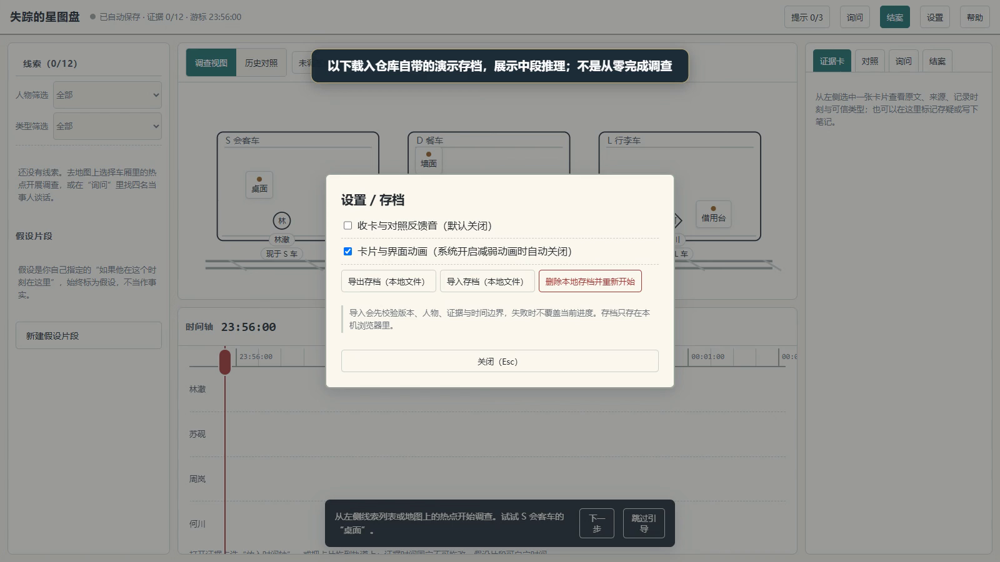

# 零点列车

失踪的星图盘：把证词放到时间里，让推理可以复核。

Atria Demo 共建作品 · 作者 **xyc**。主体开发 Qoder/Atria；Codex 独立评审、最终修复与提交整理。



## 直接体验

下载或克隆本仓库，进入根目录：

```text
node serve-demo.mjs
```

打开 http://127.0.0.1:8000/ 。仅监听本机；不需要 API Key。需要 Node.js 24.21（实际测试版本）。仓库已含 dist，可不安装依赖直接运行。

## 从源码开发

```text
npm ci
npm test
npm run build
node serve-demo.mjs
```


## 功能与使用说明

见 [Demo说明.md](Demo说明.md)。89 项自动测试通过，含本轮新增弹窗焦点回归；类型检查与生产构建通过。

首版包含一个案件，不是无限生成剧本。视频明确标注中段载入了演示存档，不代表一分钟完成全案；没有公开最终谜底。

公开的是本次提交快照，不包含私人开发仓库历史、凭据、node_modules 或无关项目。第三方库及数据遵循各自声明；本仓库公开不代表作者有权替第三方重新授权。

